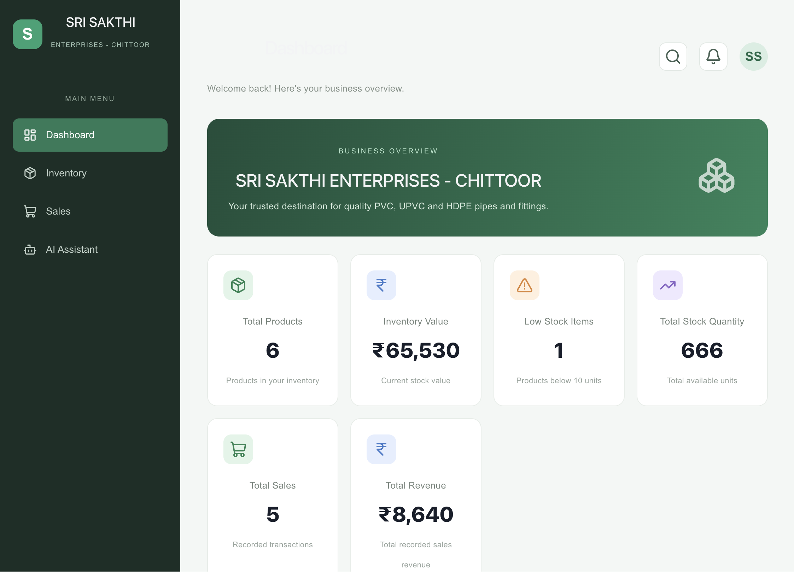
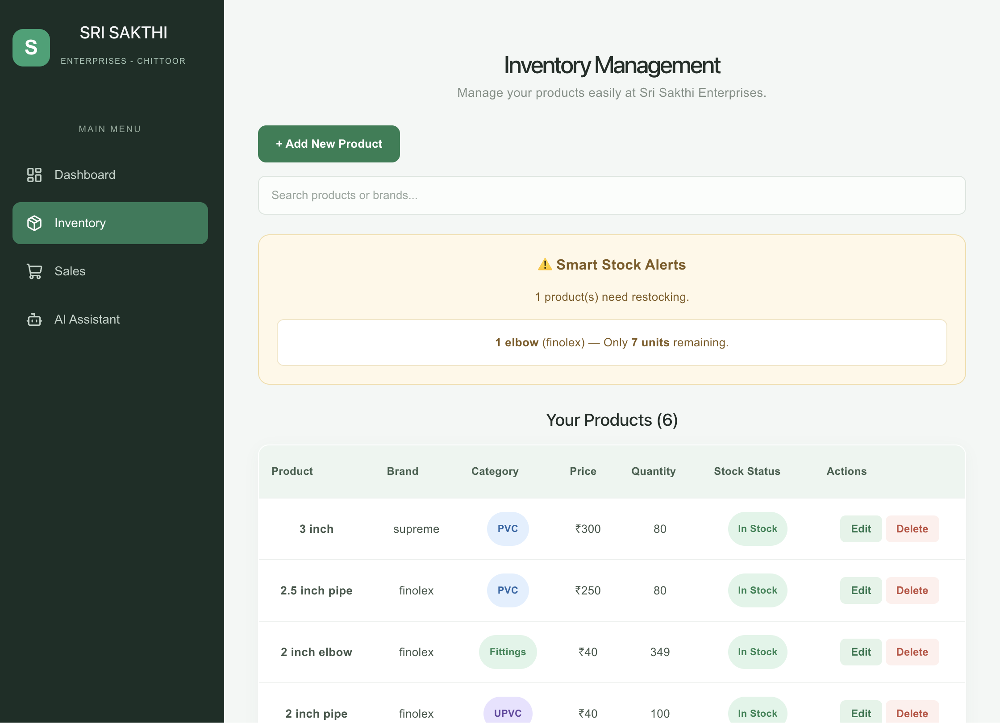
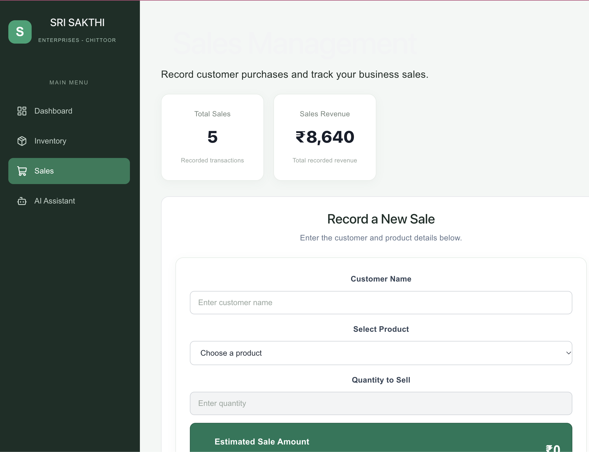
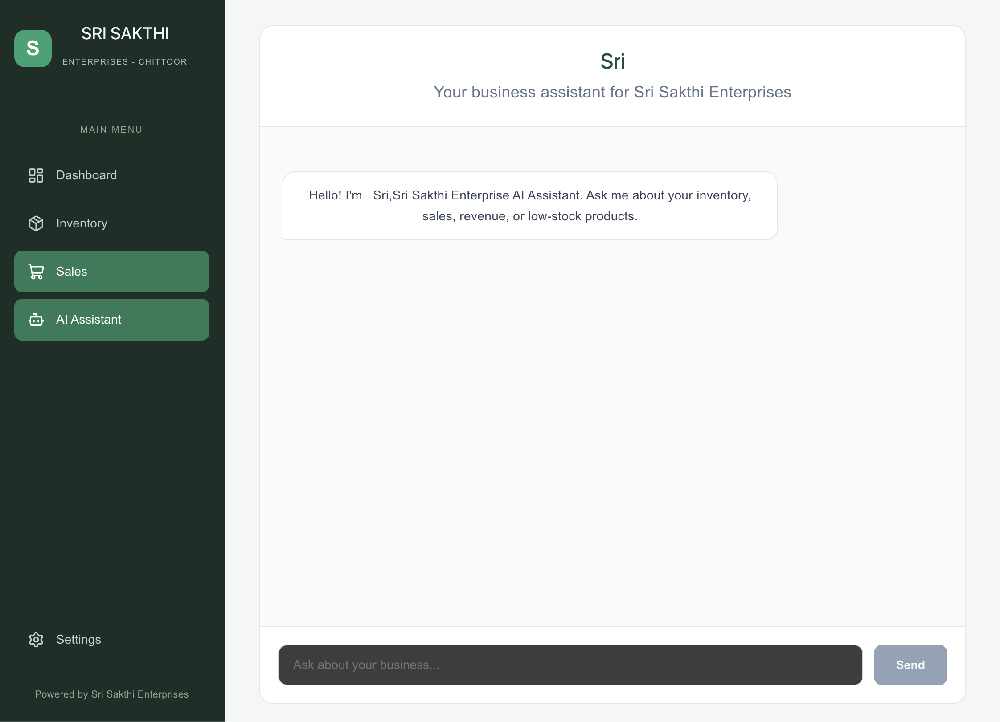

# Sri Sakthi Enterprises – Chittoor

## About the Project

Sri Sakthi Enterprises – Chittoor is an inventory and sales management application that I developed as part of my individual project.

I used a friend's business as a real-world example to understand how small businesses manage their products, stock and daily sales. The business deals with PVC, UPVC and HDPE pipes and fittings.

The main idea behind this project was to bring basic business activities into one application instead of maintaining everything separately.

## What the Application Does

**1. Dashboard**

The dashboard gives an overview of the business. It displays the total number of products, available stock, low-stock items, inventory value and sales revenue.

**2. Inventory Management**

Users can add new products, view existing products, update product information and delete products when required.

**3. Sales Management**

Users can record sales by selecting a product, entering the customer name and specifying the quantity. The application calculates the total amount and updates the available stock automatically after a successful sale.

**4. Business Assistant**

I added a simple business assistant where users can ask questions about their inventory, sales and customers.

Example questions:
- Show my inventory.
- Which products are low in stock?
- What is my total revenue?
- Who are my customers?
- Give me a business summary.

The current version uses Python keyword-based question detection and database queries to generate answers.

## Technologies Used

- **Frontend:** React.js
- **Backend:** Python and FastAPI
- **Database:** SQLite
- **Database Integration:** SQLAlchemy
- **API Requests:** Axios

## Running the Project Locally

**Backend**

```bash
cd backend
python3 -m venv venv
source venv/bin/activate
pip install -r requirements.txt
uvicorn main:app --reload
```

Backend URL: http://127.0.0.1:8000

**Frontend**

Open another terminal:

```bash
cd frontend
npm install
npm run dev
```

Frontend URL: http://localhost:5173

## What I Learned

While working on this project, I got practical experience with React, Python, FastAPI, database operations and API integration.

I also understood how frontend and backend components communicate, how to manage product and sales records, and how to implement stock updates based on sales.

## Future Improvements

I would like to add user login, better sales reports, automated restocking alerts and more advanced AI-based business analysis in future versions.

## Application Screenshots

### Dashboard


### Inventory Management


### Sales Management


### AI Business Assistant


## Developed By

Deekshith Reddy

GitHub: https://github.com/deekshith14436

---

Developed as an individual project using a real-world small-business scenario.
